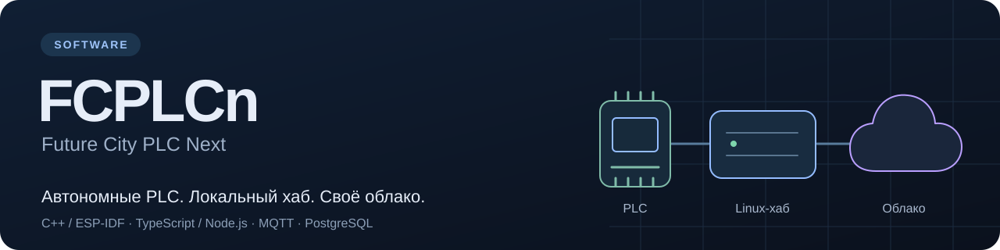
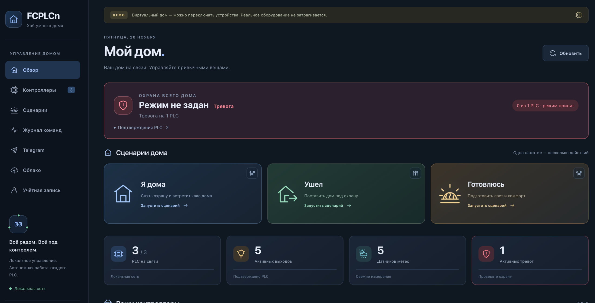
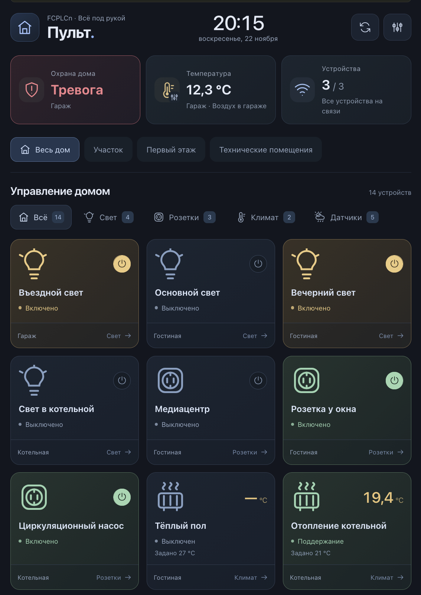
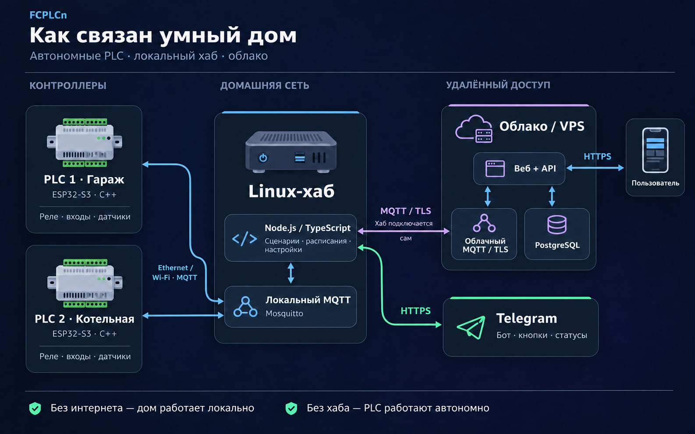
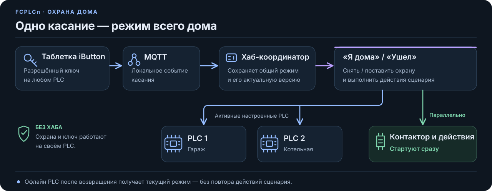
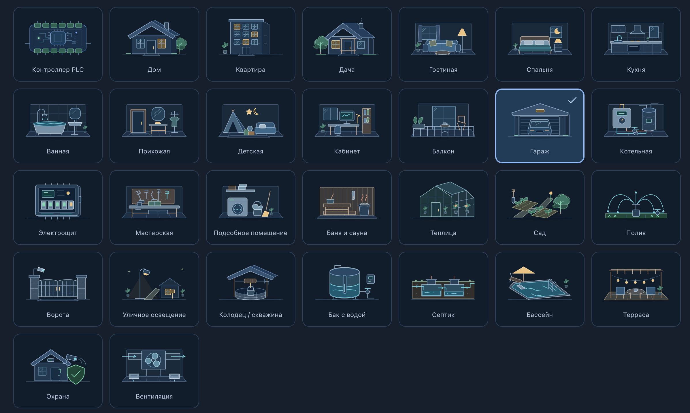
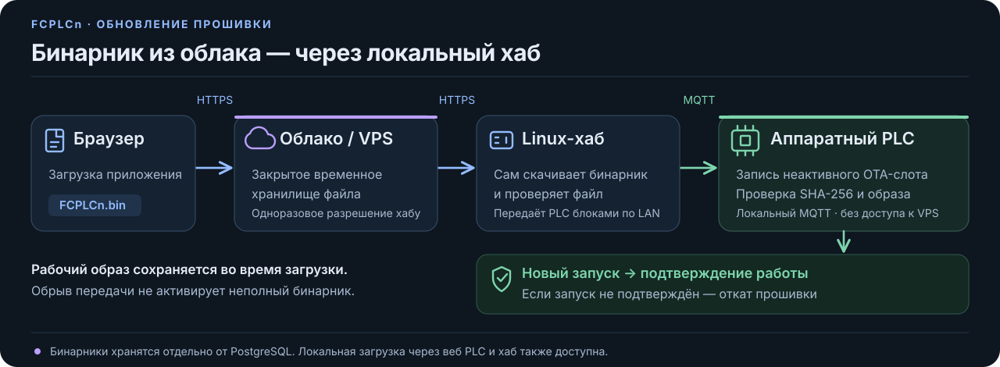

<p align="center">
  
</p>

# FCPLCn — Future City PLC Next

**Программная платформа умного дома для квартиры, частного дома и дачи.**
Аппаратные PLC управляют своим оборудованием автономно. Linux-хаб объединяет их
в одну систему, выполняет сценарии и связывает дом с Telegram и собственным облаком.
Веб-интерфейсы доступны на трёх уровнях: непосредственно на PLC, в локальном хабе
и через облачную панель.

<p align="center">
  <a href="#quick-start">Быстрый старт</a> ·
  <a href="#pult">Пульт для планшета</a> ·
  <a href="#architecture">Архитектура</a> ·
  <a href="#controllers">Контроллеры</a> ·
  <a href="#scenarios">Сценарии</a> ·
  <a href="#ota">Обновления</a> ·
  <a href="#installation">Установка на сервер</a> ·
  <a href="#development">Разработка</a>
</p>

> **Статус: активная разработка.** В README описана текущая реализация. Демо
> и автоматические проверки работают с виртуальными PLC; проверка конкретной
> платы, нагрузок и датчиков выполняется отдельно на оборудовании.

## Главное о системе

| Уровень           | Что выполняет                                                                       | Технологии                                           |
| ----------------- | ----------------------------------------------------------------------------------- | ---------------------------------------------------- |
| **PLC**           | Реле, кнопки, датчики, термостаты и местная охрана                                  | ESP32-S3 N16R8 · C++ · ESP-IDF 6.1 · FreeRTOS        |
| **Локальный хаб** | Общая панель, настройка устройств, сценарии, расписания, Telegram и связь с облаком | Linux · TypeScript · Node.js 24 · Mosquitto · PostgreSQL |
| **Облако**        | Удалённый доступ, пользователи, дома, права, журнал действий и доставка обновлений  | TypeScript · Node.js · PostgreSQL · MQTT/TLS · Caddy |
| **Браузер**       | Локальные и удалённые страницы управления                                           | TypeScript · Preact · встроенные SVG                 |

- **Дом работает без интернета:** локальные сценарии, расписания и MQTT остаются на хабе.
- **PLC работает без хаба:** локальные кнопки, термостат и охрана продолжают выполнять свою логику.
- **Настройки применяет сам PLC:** назначение портов, сохранение и результат команды подтверждаются устройством.
- **Одна панель управления:** облако использует тот же интерфейс хаба и тот же редактор PLC.
- **Пульт для планшета:** отдельная страница с крупными плитками, SVG-значками и состояниями оборудования.
- **Свои данные и сервер:** облачная часть разворачивается на собственном Linux-сервере или VPS.

## Интерфейс управления

Обзор дома показывает подключённые PLC, общий режим охраны, быстрые сценарии,
свежие показания и подтверждения команд. У каждого устройства есть своя страница
и встроенный редактор настроек. Интерфейс адаптирован для компьютера, планшета и телефона.

[](docs/readme/hub-overview.png)

_На изображении — демонстрационный дом с виртуальными устройствами. Счётчики и
тревога относятся к состоянию этого демо._

<a id="pult"></a>

## Пульт для планшета

**«Пульт»** — отдельная главная страница хаба для iPad и других планшетов,
которые используются как домашний командный экран. Крупные плитки позволяют
управлять светом, розетками и климатом, а также смотреть показания датчиков.

[](docs/readme/hub-pult.png)

Открыть его можно через пункт **«Пульт»** в меню хаба или по прямому адресу
`http://адрес-хаба:3000/#pult`. Кнопка **«Панель хаба»** возвращает полный интерфейс
с контроллерами, сценариями и настройками.

- **Сводка дома:** часы и дата, состояние охраны, температура и количество устройств на связи.
- На вкладке **«Сценарии»** касание мгновенного сценария запускает его один раз.
  Касание плитки расписания включает или выключает автоматический запуск. Включённые расписания подсвечены.
- **Фильтры:** выбор помещения и типа оборудования — свет, розетки, климат или датчики.
- **Наглядные показания:** SVG-значки, янтарная температура и бирюзовая влажность под ней.
- **Закреплённый датчик температуры:** в верхней карточке выбираются контроллер и датчик;
  выбор сохраняется на хабе и действует в локальной и облачной панели.
  При недоступности источника остаются его имя и прочерк.
- **Подтверждённое управление:** состояние плитки меняется после ответа PLC.
  Уведомления появляются поверх страницы, сохраняя положение кнопок;
  при потере свежей связи управление блокируется.

Локальный вход сохраняется после перезапуска хаба. После пробуждения планшета
панель заново запрашивает актуальные состояния.

_На скриншоте — демонстрационный дом с виртуальными PLC._
Подробнее: [настройка и работа пульта](hub/README.md#пульт-для-планшета).

<a id="architecture"></a>

## Как всё связано

[](docs/readme/architecture.png)

PLC подключаются по Ethernet W5500 или Wi-Fi к **локальному** Mosquitto.
Приложение хаба получает состояния, отправляет адресованные команды и проверяет
подтверждения. Только хаб связывает локальную сеть с облаком.

На VPS работает **второй, отдельный MQTT-брокер**. Хаб сам открывает исходящее
TLS-соединение; облачный API передаёт по нему разрешённые запросы и получает
результаты. Облачных учётных данных на PLC нет. Проброс входящих портов домашнего
роутера для этого обмена не требуется.

Telegram-бот также выполняется на хабе и обращается к Telegram по исходящему HTTPS.
Он использует локальные устройства независимо от собственного облачного сервера.

| Соединение                 | Транспорт                        | Содержимое                                                        |
| -------------------------- | -------------------------------- | ----------------------------------------------------------------- |
| PLC ↔ локальный MQTT ↔ хаб | MQTT по LAN, обычно `1883`       | Состояния, события, команды, подтверждения, настройка и OTA-блоки |
| Локальный браузер ↔ хаб    | HTTP, обычно `3000`              | Общая панель дома и встроенный редактор PLC                       |
| Локальный браузер ↔ PLC    | HTTP через Ethernet / Wi-Fi / AP | Собственный сервисный интерфейс устройства                        |
| Хаб ↔ облачный MQTT        | MQTT 5 / TLS, обычно `8883`      | Разрешённые запросы, ответы и публичные снимки состояния          |
| Удалённый браузер ↔ облако | HTTPS                            | Веб-панель, пользователи, управление и загрузка прошивки          |
| Хаб ↔ облачный API         | HTTPS                            | Первичная привязка и скачивание OTA-файла                         |
| Хаб ↔ Telegram             | HTTPS Bot API                    | Получение сообщений и отправка ответов с обычной клавиатурой      |
| Хаб ↔ локальный PostgreSQL | Закрытая сеть Compose            | Учётные записи, история метеодатчиков и журнал событий хаба      |
| Облачный API ↔ PostgreSQL  | Закрытая сеть сервера            | Пользователи, права, дома, привязки, журнал и последние снимки    |

Локальный и облачный брокеры связаны прикладным адаптером хаба. Произвольные темы
локальной сети в облако не пересылаются. Подробности:
[концепция архитектуры](docs/architecture/CONCEPT.md) и
[границы доступа](docs/architecture/SECURITY.md).

<a id="controllers"></a>

## Что умеет PLC

В текущей прошивке реализованы **семь типов программных контроллеров**.
У одного PLC может быть несколько розеток, светильников, датчиков, термостатов, баков и правил полива.

| Контроллер    | Возможности                                                                                                                     |
| ------------- | ------------------------------------------------------------------------------------------------------------------------------- |
| **Розетки**   | Назначение реле, управление из веба и удалённо, необязательная кнопка на цифровом входе, сохранение состояния                   |
| **Свет**      | Та же автономная механика управления с собственной индикацией и настройками каналов                                             |
| **Метео**     | DHT22 и DS18B20; поиск OneWire, несколько DS18B20 на одной линии, выбор датчика по серийному номеру                             |
| **Термостат** | Локальный датчик из «Метео», реле, нагрев или охлаждение, уставка, гистерезис, индивидуальное включение и необязательная кнопка |
| **Охрана**    | Сирена, герконы и датчики движения, разрешённые ключи iButton, задержки входа и выхода, восстановление режима и тревоги         |
| **Баки**      | До трёх датчиков уровня, защита откачивающего насоса, кран наполнения по выбранному уровню, проценты и SVG-бак               |
| **Полив**     | Реле крана, дни недели, время и длительность. По желанию можно выбрать бак для защиты от полива без воды. |

### Порты и локальное управление

Каналы имеют стабильные смысловые имена:

| Ресурс           | Имена текущего профиля  | Назначение                                  |
| ---------------- | ----------------------- | ------------------------------------------- |
| Реле             | `rly-0/1` … `rly-0/16`  | Розетки, свет, термостаты, сирена, насосы и краны |
| Дискретные входы | `in-0/1` … `in-0/16`    | Кнопки, герконы, датчики движения и уровня воды |
| Сенсорные линии  | `sens-0/1` … `sens-0/8` | DHT22, OneWire/DS18B20, считыватель iButton |

Редактор учитывает занятость портов: занятое реле или вход показывается с владельцем
и недоступно для другого назначения. OneWire допускает несколько датчиков на одной
линии; один датчик «Метео» можно использовать в нескольких термостатах.

Возвратная кнопка переключает канал по подтверждённому переходу **HIGH → LOW**.
Есть подавление дребезга и ожидание отпускания: удержание кнопки и обратный переход
не создают повторных переключений.

### Автономный термостат

Контур всегда исполняется в C++ на ответственном PLC. Для автономной работы ему
нужны собственные локальные датчик и выход. Хаб задаёт настройки и разрешение
работы, а PLC сам решает, когда переключать реле.

При уставке **22 °C** и гистерезисе **1 °C**:

| Режим      | Включение            | Выключение           |
| ---------- | -------------------- | -------------------- |
| Нагрев     | При **21 °C** и ниже | При **22 °C** и выше |
| Охлаждение | При **23 °C** и выше | При **22 °C** и ниже |

Гистерезис выбирается от **1 до 20 °C**, по умолчанию — **1 °C**.
Минимальные времена ON и OFF заданы общей константой **60 секунд**.
При потере достоверного измерения или отказе выхода действует локальная политика
безопасного выключения; устаревшие показания не используются бессрочно.

### Автономный контроль бака

По умолчанию у бака два контактных датчика — нижний и верхний; можно настроить
до трёх. Контакт замыкается в воде. Откачивающий насос включается, пока нижний
датчик в воде, и выключается при её отсутствии. Кран наполнения открыт ниже
выбранного уровня и закрывается при его достижении.

PLC выполняет обе функции локально. Мониторинг включается отдельно для каждого
бака; его выключение останавливает насос и закрывает кран. Веб PLC, хаб и облако
показывают большой цилиндрический SVG-бак с голубой водой и дискретным уровнем:
**0/50/100%** для двух датчиков или **0/33/67/100%** для трёх. Ошибка датчиков
отображается отдельно и выключает выходы.

[Настройка, логика, проценты и API баков](docs/architecture/TANKS.md).

### Полив по расписанию

На одном PLC можно задать несколько правил. Например, один кран поливает грядки
по понедельникам, средам и пятницам в 07:00 в течение 15 минут. Второе правило
может открывать этот же кран вечером. На пульте каждое правило занимает свою плитку.
Полив может работать по таймеру без бака, с местным баком или с баком на другом
PLC. Свежие показания удалённого бака передаёт хаб по локальной сети. Если
выбранный бак опустел или его показания пропали, PLC закрывает кран.
После наполнения следующий полив начнётся в очередное назначенное время.

[Как настроить полив и выбрать бак](docs/architecture/IRRIGATION.md).

### Аппаратный профиль

Поддерживаются две платы; GPIO, адреса и тип постоянной памяти задаются профилем.

| Модель                | Технический ID      | Реле / входы | Память состояний            |
| --------------------- | ------------------- | ------------ | --------------------------- |
| **FCPLCN-161608-1v0** | `fcplcn-161608-1v0` | 16 / 16      | FRAM FM24CL64B-GTR, 8 КиБ   |
| **FCPLC-080806-3v1**  | `fcplc-080806-3v1`  | 8 / 8        | EEPROM 24LC512-I/SM, 64 КиБ |

У предыдущей платы шесть универсальных и две отдельные OneWire-линии, сеть Wi-Fi.
[Её распиновка, сборка и исправление подключения EEPROM](docs/hardware/FCPLC-080806-3v1.md).
Ниже приведена конфигурация современной платы FCPLCN-161608-1v0.

| Узел                        | Текущая конфигурация                                                                |
| --------------------------- | ----------------------------------------------------------------------------------- |
| Микроконтроллер             | ESP32-S3 N16R8: 16 МиБ Flash, 8 МиБ PSRAM                                           |
| Сеть                        | Wi-Fi AP/STA и Ethernet W5500; отдельные настройки и статусы                        |
| Реле и входы                | MCP23017, I²C `0x20` и `0x21`                                                       |
| Энергонезависимые состояния | FRAM FM24CL64B-GTR, 8 КиБ, I²C `0x50`                                               |
| Время                       | RTC DS3231MZ+, I²C `0x68`, системные часы ESP и NTP                                 |
| Диагностика                 | Две I²C-шины, карта GPIO, состояния входов/выходов, память, задачи и причина сброса |
| RS485                       | Назначения присутствуют в профиле; протокольный драйвер ещё не реализован           |

После чтения и проверки сохранённого профиля устанавливаются безопасные уровни его GPIO. Задачи I/O и автоматики
контролируются watchdog. При обнаружении сброса настроек MCP23017 драйвер проверяет
регистры и восстанавливает направления и разрешённые выходные состояния.
У термостатов восстановление реле дополнительно зависит от локального регулятора.

Аппаратные исходники находятся в отдельном проекте `fcplcn-boards`.
Описание прошивки и аппаратных ограничений: [firmware/base/README.md](firmware/base/README.md).

<a id="scenarios"></a>

## Сценарии дома и общая охрана

На главной странице находятся три быстрых сценария:

| Сценарий      | Базовое действие                                        | Что можно добавить                                                              |
| ------------- | ------------------------------------------------------- | ------------------------------------------------------------------------------- |
| **Я дома**    | Снять охрану на всех известных настроенных активных PLC | Включить контактор, свет, розетки или термостаты                                |
| **Ушел**      | Поставить эти PLC на охрану                             | Отключить выбранные нагрузки или изменить разрешение работы оборудования        |
| **Готовлюсь** | Выполнить назначенные действия                          | Подготовить освещение и отопление без автоматической смены общего режима охраны |

В разделе **«Сценарии»** отдельно показаны мгновенные сценарии и сценарии
**по расписанию**. Для расписания задаются дни недели, время и часовой пояс.
Планировщик работает на Linux-хабе, в том числе для сценариев, созданных из облака.

Каждое действие явно задаёт цель и результат: конкретный PLC, канал и включение
или выключение. Действие термостата включает его автономную работу, а дальнейшее
переключение реле выполняет сам PLC.

### Одна таблетка — режим всего дома

[](docs/readme/ibutton-flow.svg)

Новое касание разрешённой таблетки на одном PLC запускает **«Я дома»** или
**«Ушел»**; следующее отдельное касание переключает общий режим обратно.
Удержание таблетки и повторная доставка одного события не создают новых сценариев.

- Все известные PLC учитываются автоматически; отдельные списки целей для общей охраны не нужны.
- Контакторы и дополнительные действия запускаются **сразу**, независимо от ожидания подтверждений остальных PLC.
- Если PLC отсутствует, хаб сохраняет текущий желаемый режим охраны и показывает отсутствие подтверждения.
- После возвращения PLC получает **только актуальный режим охраны**. Промежуточные режимы и старые действия сценария не воспроизводятся.
- При недоступном хабе таблетка продолжает управлять местной охраной своего PLC.

Включение модуля охраны и постановка на охрану — разные операции. Задержки входа
и выхода, состояния постановки и тревога отображаются отдельно от подтверждения
принятого режима.

Обычные оперативные команды имеют срок действия и не накапливаются до возвращения
устройства. Согласование сохранённого общего режима охраны — отдельный механизм.
Протокол и MQTT-права описаны в [SECURITY-SYNC.md](hub/deploy/SECURITY-SYNC.md).

## Telegram

Бот работает **на локальном хабе**. В его настройках задаются Bot API token
и список разрешённых личных Chat ID с понятными именами пользователей.
Последний написавший отображается отдельно: его можно проверить и явно добавить
в список доступа. Новое сообщение само по себе доступа не предоставляет.

Обычная клавиатура с emoji построена так:

```text
🏠 Я дома · 🚪 Ушел · 🌅 Готовлюсь
                  ↓
             Устройства
                  ↓
      Розетки · Свет · Метео
        Термостаты · Охрана
           Баки · Полив
                  ↓
       Показания и управление
```

Через бота можно изменить уставку, режим и гистерезис термостата, порог
наполнения бака, расписание и источник воды полива. Сценарии с расписанием
можно поставить на паузу и возобновить. Бот получает сообщения через исходящий
HTTPS и использует тот же сервис управления PLC, что и веб-панель.
Настройка и поведение: [документация хаба](hub/README.md#telegram).

## Облако и пользователи

Облако связывает пользователя с выбранным домом и его локальным хабом.
Первичная привязка выполняется по одноразовому коду. Хаб получает отдельные
отзываемые полномочия и проверяет сертификат и имя облачного MQTT-сервера.

| Роль             | Возможности                                                            |
| ---------------- | ---------------------------------------------------------------------- |
| **Владелец**     | Настройка дома и устройств, участники, сценарии, прошивки и управление |
| **Пользователь** | Управление оборудованием и запуск разрешённых сценариев                |
| **Наблюдатель**  | Просмотр состояний                                                     |

Право управления охраной назначается пользователю отдельно. Права проверяются
облачным API и повторно локальным хабом. Для учётной записи доступны TOTP
и коды восстановления.

При потере WAN облако отмечает данные как устаревшие и отклоняет управление
без постановки команд в очередь. Локальная система продолжает работу.
Описание API и состава сервера: [cloud/README.md](cloud/README.md).

## Иллюстрации устройств

Для карточек PLC доступны **30 встроенных SVG-иллюстраций**: дом, квартира, дача,
помещения, гараж, котельная, участок и оборудование. Выбор сохраняется вместе
с именем и комнатой на хабе и одинаково отображается в локальной и облачной панели.

[](docs/readme/device-illustrations.png)

_Это каталог оформления карточек. Иллюстрация обозначает помещение или назначение
PLC; доступные программные контроллеры перечислены в разделе «Что умеет PLC»._

<a id="ota"></a>

## Обновление прошивки

Образ приложения загружается через собственный веб PLC, локальную панель хаба
или облачную страницу обновления. При установке из облака файл проходит такой путь:

[](docs/readme/ota-flow.svg)

1. Облако принимает файл в закрытое временное файловое хранилище.
2. Хаб получает задание и скачивает файл по HTTPS с одноразовым разрешением.
3. Хаб проверяет образ и передаёт его подтверждаемыми блоками через локальный MQTT.
4. PLC записывает неактивный OTA-раздел, проверяет целостность и совместимость приложения.
5. После перезагрузки проверяется запуск нового образа. Неподтверждённый запуск использует механизм rollback.

| Файл                  | Использование                                            |
| --------------------- | -------------------------------------------------------- |
| **`FCPLCn.bin`**      | Обновление приложения через веб / хаб / облако           |
| **`FCPLCn-full.bin`** | Первичная USB-прошивка с загрузчиком и таблицей разделов |

Во время перезагрузки PLC локальные контуры временно останавливаются и затем
проходят штатный безопасный запуск. Обновление приложения сохраняет NVS,
постоянную память и аппаратный профиль. Прерванная передача не возобновляется автоматически.

SHA-256 проверяет целостность файла; подпись издателя и Secure Boot относятся
к отдельным механизмам и в текущий OTA-путь не входят.
Подробности: [OTA PLC](firmware/base/README.md#обновление-приложения-через-веб)
и [OTA из облака](cloud/README.md#обновление-приложения-plc-из-облака).

## Автономность и восстановление связи

| Ситуация                            | Что продолжает работать                                                      | Что становится недоступно                                                   |
| ----------------------------------- | ---------------------------------------------------------------------------- | --------------------------------------------------------------------------- |
| Нет интернета или VPS               | PLC, локальная панель, MQTT, сценарии и расписания хаба                      | Облачный доступ; Telegram при отсутствии интернета                          |
| Приложение хаба остановлено         | Локальные функции каждого PLC                                                | Общая панель, центральные сценарии, Telegram и облачное управление объектом |
| Локальный брокер или LAN недоступны | Местные кнопки, термостат и охрана каждого PLC                               | Команды и свежие состояния изолированных устройств через хаб                |
| Один PLC выключен                   | Остальные PLC и хаб                                                          | Его оборудование и актуальные показания                                     |
| PLC вернулся после отсутствия       | Обмен после получения свежего состояния; согласование текущего режима охраны | Автоматического повторения старых действий сценария нет                     |

Термостат зависит от локальных измерений своего PLC. Резервирование хаба,
автоматическая передача его роли другому компьютеру и автономные контуры
на единственном удалённом датчике этой реализацией не предполагаются.

## Настройки и хранение данных

| Где                             | Что хранится                                                                                              |
| ------------------------------- | --------------------------------------------------------------------------------------------------------- |
| **PLC / Flash NVS**             | Название устройства, сеть, MQTT, аппаратный профиль, учётная запись и настройки контроллеров              |
| **PLC / FRAM или EEPROM**       | Подтверждённые состояния розеток и света, индивидуальные разрешения термостатов, режим и тревога охраны   |
| **Хаб / JSON на диске**         | Имена, комнаты, картинки, сценарии, расписания, общий режим охраны, веб-сессии и привязка к облаку |
| **Хаб / PostgreSQL**           | Локальная учётная запись, пользователи и настройки Telegram, почасовая история метеодатчиков, журнал команд, запусков сценариев и связи с PLC |
| **Хаб / RAM**                   | Текущая телеметрия PLC                                                                                     |
| **Облако / PostgreSQL**         | Пользователи, дома, права, сессии, привязки хабов, журнал удалённых действий и последние публичные снимки |
| **Облако / файловое хранилище** | Временные OTA-бинарники и их метаданные                                                                   |

Подтверждённые состояния записываются в выбранную профилем FRAM или EEPROM
без перезаписи полной NVS-конфигурации. Общий журнал использует проверку целостности
и два слота; EEPROM учитывает границы страниц и время программирования.
Текущие измерения и таймеры локальных циклов остаются в RAM.

### Резервная копия PLC

Вкладка **«Система»** позволяет скачать полную JSON-конфигурацию и загрузить её
на другой PLC с совпадающим аппаратным профилем. При несовпадении профиля
импорт отклоняется. Имя, настройки сети, контроллеры и подтверждённые состояния
переносятся; MAC и технический `deviceId` остаются собственными у целевого устройства.

Копия содержит сетевые секреты и данные авторизации, поэтому предназначена
для закрытого хранения. Несохранённые поля формы, текущие измерения и прошивка
не являются частью конфигурационной копии.

<a id="quick-start"></a>

## Быстрый старт без оборудования

Все команды в этом README выполняются из **корня `fcplcn-soft/`**.
Для веб-части нужен **Node.js 24.x** и npm.

### 1. Посмотреть общую панель хаба

```sh
npm --prefix hub ci
npm --prefix hub run demo
```

Откройте **[http://127.0.0.1:3000](http://127.0.0.1:3000)**.
Вход: **`admin`**, пароль — **пустой**.

Демо запускает виртуальные PLC, позволяет переключать каналы и проверять
сценарии. Подключение к реальному MQTT и управление физическим оборудованием
в этом режиме не выполняются.

### 2. Посмотреть сервисный веб самого PLC

В отдельном терминале:

```sh
tools/firmware/preview-base
```

Откройте **[http://127.0.0.1:4174](http://127.0.0.1:4174)**.
Начальный вход: **`admin`**, пароль — **пустой**. Для просмотра не нужны
ESP-IDF, прошивка контроллера или подключённая плата.

### 3. Собрать хаб и облако

```sh
npm --prefix hub ci
npm --prefix cloud ci
npm --prefix hub run build
npm --prefix cloud run build
```

**Хаб собирается первым:** облачная сборка включает его общий интерфейс
и сервисную панель PLC. Для запуска облака дополнительно требуются PostgreSQL
и отдельный Mosquitto с TLS и dynamic-security.

### Учётные записи по умолчанию

На новой установке PLC, хаба и облака используется логин **`admin`**
с пустым паролем. Логин и пароль меняются через соответствующую веб-панель;
изменённые данные сохраняются после перезапуска. Это отдельные учётные записи
трёх уровней. MQTT-полномочия устройств настраиваются отдельно от веб-входа.

## Запуск с реальными устройствами

<a id="installation"></a>

### Установщик для хаба и облака

Для первой установки скачайте репозиторий целиком:

```sh
git clone https://github.com/LittleBuster/fcplcn-soft.git
cd fcplcn-soft
./install.sh
```

В меню выберите, что будет работать на этой машине:

```text
FCPLCn — выбор компонента
  1. cloud — облако / VPS
  2. hub   — локальный хаб
  0. Выход
```

Поддерживаются Debian 13 x86-64/ARM64, Armbian на Orange Pi и macOS Apple Silicon,
включая M5. Целевая плата — Orange Pi Zero 3 с Allwinner H618, 1 ГБ RAM
и 64-битным Armbian. Хаб и облако используют Node.js 24; 32-битный ARM не поддерживается.

После выбора роли `install.sh` выполняет установку:

1. Определяет ОС, архитектуру и объём памяти.
2. Устанавливает отсутствующие системные зависимости, Docker и Compose.
   Node.js и зависимости приложений находятся внутри контейнеров.
3. Получает образ приложения для выбранной версии исходников. Для Orange Pi
   Zero 3 с 1 ГБ используется готовый ARM64-образ из GHCR, заранее собранный
   GitHub Actions. Публикация образов настраивается в вашем GitHub-репозитории.
4. Создаёт постоянное хранилище настроек и учётные данные служб, затем запускает
   контейнеры через Compose. Домен при первой установке облака запрашивается
   в терминале; его DNS должен указывать на сервер.
5. Проверяет готовность служб и выводит адрес веб-интерфейса.

| Выбранный компонент | Запускаемые службы                                        | Веб-интерфейс         |
| ------------------- | --------------------------------------------------------- | --------------------- |
| **hub**             | Mosquitto, приложение хаба и локальный PostgreSQL         | `http://IP-ХАБА:3000` |
| **cloud**           | PostgreSQL, MQTT/TLS, приложение облака и Caddy для HTTPS | `https://ваш-домен`   |

Первый вход — **`admin`**, пароль пустой. Логин и пароль меняются через веб-панель.
На Mac первый запуск Docker Desktop может потребовать завершить настройку в его окне.
После запуска хаба укажите его LAN-адрес и отдельные MQTT-полномочия в настройках PLC.

Для последующего обновления запустите `./update.sh` и выберите **1 — cloud** или
**2 — hub**. Скрипт получает выбранный commit из GitHub и образы всех служб
выбранной роли, создаёт полную резервную копию, применяет обновление и проверяет
готовность служб. GitHub Actions публикует образы, а обновление запускается
на самом хабе или VPS командой `./update.sh`.

**После обновления сохраняются настройки и базы.** Учётная запись хаба,
пользователи Telegram и почасовая история перенесутся из файлов в локальный
PostgreSQL при первом запуске. Резервная копия содержит исходники, образы служб,
настройки и постоянные тома. Конфигурации PLC остаются на самих устройствах.

Подробности установки, настройка GitHub/GHCR, расположение данных, резервные копии
и откат: **[инструкция установщика](deploy/README.md)**.

### Ручное развёртывание Linux-хаба

Для обычного развёртывания подготовлены Docker Compose и пример systemd-службы.
Нужны Linux mini PC, локальная сеть и индивидуальные MQTT-полномочия PLC.

1. Подготовьте `hub/.env` по [примеру](hub/.env.example).
2. Настройте локальный Mosquitto и его ACL по [инструкции хаба](hub/README.md#linux-docker-compose).
3. На PLC в разделе **«Хаб»** укажите адрес mini PC, порт и учётную запись MQTT.
4. Дождитесь свежего состояния устройства в панели и настройте его каналы.

Собственный сервисный веб PLC сохраняется для первоначальной настройки,
диагностики сети и восстановления доступа.

### Собственный сервер / VPS

В облачном развёртывании предусмотрены PostgreSQL, облачный Mosquitto,
приложение FCPLCn и Caddy для HTTPS. Нужны свой домен и сервер с Docker Compose.

1. Подготовьте DNS и сервер по [cloud/DEPLOY.md](cloud/DEPLOY.md).
2. Запустите облачную часть и создайте дом.
3. Выпустите код подключения хаба.
4. В локальной панели **«Облако»** укажите HTTPS-адрес сервера и код.
5. Добавьте пользователей и назначьте права.

При работе через облако все команды PLC проходят через локальный хаб.

<a id="development"></a>

## Структура программного проекта

```text
fcplcn-soft/
├── install.sh                     установка cloud или hub
├── update.sh                      обновление контейнеров cloud или hub
├── deploy/                        платформы, команды обслуживания, копии и восстановление
├── config/
│   └── product.json                 каноническое название и ID продукта
├── firmware/base/
│   ├── main/
│   │   ├── config/                 NVS, журнал состояний и резервные копии
│   │   ├── controllers/            автономная логика оборудования
│   │   ├── hardware/               профили, GPIO, I²C и расширители
│   │   ├── network/                Wi-Fi, W5500 и локальный MQTT
│   │   ├── sensors/                DHT22 и OneWire
│   │   ├── system/                 watchdog, OTA и диагностика
│   │   ├── time/                   RTC и NTP
│   │   └── web/                    HTTP API и встроенные ресурсы
│   ├── web/                        сервисный интерфейс PLC
│   ├── simulator/                  запуск без физического PLC
│   └── tests/                      нативные и браузерные проверки
├── hub/
│   ├── server/                     API, сценарии, Telegram, облачный адаптер
│   ├── src/                        MQTT, модель устройств и демонстрация
│   ├── shared/                     контракты и общие типы
│   ├── web/src/                    интерфейс хаба
│   ├── tests/                      серверные и браузерные проверки
│   └── deploy/                     Docker, Mosquitto и systemd
├── cloud/
│   ├── server/                     API, PostgreSQL, права и связь с хабами
│   ├── shared/                     облачные контракты
│   ├── web/src/                    оболочка облачной панели
│   ├── tests/                      проверки API, доступа и всей цепочки
│   └── deploy/                     VPS, HTTPS и отдельный MQTT-брокер
├── tools/
│   ├── firmware/                   сборка, тесты и документация прошивки
│   ├── esp/                        esptool и определение портов
│   └── web/                        оформление исходников веба
└── docs/
    ├── architecture/               концепция и границы доступа
    └── readme/                     изображения и схемы этой страницы
```

Веб-интерфейсы хаба и облака разделены на `app/`, `pages/`, `components/`,
`hooks/` и `styles/`. Крупные разделы хаба вынесены в `features/scenes/`
и `features/telegram/`. `main.tsx` каждого интерфейса содержит только запуск;
API-запросы, состояние и разметка страниц находятся в отдельных модулях.

TypeScript выполняется на Node.js и в браузере. Автономная логика PLC написана
на C++ и не требует выполнения TypeScript на ESP32.

## Сборка прошивки

Целевая платформа — **ESP-IDF 6.1 / ESP32-S3 N16R8**.
Подготовка SDK, Python, CMake и инструментов описана в
[tools/firmware/README.md](tools/firmware/README.md).

Готовый wrapper проверен в подготовленном окружении **macOS Apple Silicon / Homebrew**:

```sh
tools/firmware/build-base
# Первоначальный профиль тестовой платы с EEPROM:
FCPLCN_BOARD_PROFILE=fcplc-080806-3v1 tools/firmware/build-base
```

SDK и команды `idf.py` можно использовать для собственной среды сборки;
готовые wrapper-скрипты содержат пути подготовленного macOS-окружения.
Каталог сборки ESP-IDF должен иметь **ASCII-путь**:

```text
~/esp/build/fcplcn/base/
```

Сам каталог исходников может находиться по пути с кириллицей.
Готовые образы и контрольные суммы современной платы появляются в **`firmware/base/dist/`**.
Вариант EEPROM использует отдельный **`firmware/base/dist/fcplc-080806-3v1/`**
и каталог сборки `~/esp/build/fcplcn/base-fcplc-080806-3v1/`. Метаданные начального
профиля включены в `firmware-profile.json`; сохранённая модель PLC имеет приоритет.
Сервисный USB-C текущей платы требует штатного питания 12 В: USB её не питает.

## Проверки без физического PLC

Локальная логика и драйверы проверяются на компьютере с имитацией времени,
входов, датчиков, повреждений памяти и обрывов связи. Браузерные наборы работают
с изолированными виртуальными домами и PLC.

| Проверка                                 | Команда из корня `fcplcn-soft/`           |
| ---------------------------------------- | ----------------------------------------- |
| Контроллеры, кнопки, термостаты и охрана | `tools/firmware/test-base-sockets`        |
| MCP23017, FRAM и аппаратный I/O          | `tools/firmware/test-base-hardware-io`    |
| Журнал состояний FRAM/EEPROM             | `tools/firmware/test-base-fram-journal`   |
| Начальные профили и упаковка образов     | `tools/firmware/test-base-board-profiles` |
| Драйверы FRAM и EEPROM                   | `tools/firmware/test-base-state-memory`   |
| Перенос полной конфигурации              | `tools/firmware/test-base-backup`         |
| Удалённая настройка PLC                  | `tools/firmware/test-base-management`     |
| Запись и активация OTA                   | `tools/firmware/test-base-ota`            |
| Сервисный интерфейс PLC                  | `tools/firmware/test-base-ui`             |
| Сервер хаба                              | `npm --prefix hub test`                   |
| Веб хаба                                 | `npm --prefix hub run test:browser`       |
| Сервер облака                            | `npm --prefix cloud test`                 |
| Веб облака                               | `npm --prefix cloud run test:browser`     |

Перед браузерными проверками нужны собранные хаб и облако и установленный
Chromium Playwright. Установка браузера после установки зависимостей хаба:

```sh
(cd hub && npx playwright install chromium)
```

Сервисный веб PLC использует отдельный веб-стенд. Для `test-base-ui` его зависимости
и браузер устанавливаются отдельно:

```sh
npm ci --prefix tools/firmware/web-smoke
(cd tools/firmware/web-smoke && npx playwright install chromium)
```

Для облачных проверок используется отдельная тестовая PostgreSQL-база
(`FCPLCN_CLOUD_TEST_DATABASE_URL`); полный интеграционный стенд также использует
настроенный TLS MQTT-брокер. Подготовка и особенности тестов описаны в
[документации облака](cloud/README.md#проверки).

### Стиль кода и документация

Используются единые настройки форматирования, clang-format, Prettier и
русские JSDoc-пояснения веб-компонентов. Именованные функции production C++
имеют Doxygen-контракты в заголовках и исходных файлах.

В подготовленном окружении:

```sh
# Проверка оформления веб-интерфейсов
node tools/web/format-code.mjs --check

# Проверка Doxygen и генерация документации C++
tools/firmware/check-doxygen
tools/firmware/docs-base
```

Для установки закреплённого форматтера:
`npm ci --prefix tools/firmware/code-style`.
Свойства продукта берутся из [config/product.json](config/product.json).

## Текущие границы реализации

| Уже работает                                                | Следующие этапы                                             |
| ----------------------------------------------------------- | ----------------------------------------------------------- |
| Пять типов контроллеров, локальная автоматика и FRAM/EEPROM | Дополнительные программные контроллеры и аппаратные профили |
| Ручные сценарии и недельные расписания хаба                 | Условные сценарии по показаниям датчиков                    |
| Веб PLC, хаба и облака; Telegram                            | Дополнительные интеграции                                   |
| Облачные права, последние снимки и журнал действий          | Полная долговременная история телеметрии                    |
| Аппаратная карта RS485 и безопасные стартовые уровни        | Протокольный драйвер RS485                                  |

Автоматическое резервирование Linux-хаба сейчас не реализовано. Наличие
иллюстрации полива, ворот, септика или вентиляции в каталоге не означает
наличия отдельного программного модуля такого типа.

## Документация по разделам

| Документ                                          | Что внутри                                                       |
| ------------------------------------------------- | ---------------------------------------------------------------- |
| [Концепция системы](docs/architecture/CONCEPT.md) | Границы хаба, PLC и облака; автономность и поведение при отказах |
| [Границы доступа](docs/architecture/SECURITY.md)  | Авторизация, сетевые каналы и работа с секретами                 |
| [Прошивка PLC](firmware/base/README.md)           | Контроллеры, аппаратные профили, FRAM/EEPROM, сеть, API и OTA    |
| [Linux-хаб](hub/README.md)                        | Демо, устройства, Telegram, сценарии, расписания и MQTT          |
| [Общая охрана](hub/deploy/SECURITY-SYNC.md)       | iButton, текущий режим дома, свежесть и восстановление связи     |
| [Облачный сервер](cloud/README.md)                | Пользователи, права, привязки и удалённое управление             |
| [Установщик и обновление](deploy/README.md)       | Debian, Armbian, macOS, GitHub-образы, резервные копии и откат   |
| [Развёртывание VPS](cloud/DEPLOY.md)              | Docker Compose, HTTPS, PostgreSQL, MQTT и резервные копии        |
| [Инструменты прошивки](tools/firmware/README.md)  | SDK, сборка, симулятор, тесты и оформление кода                  |

---

**FCPLCn — Future City PLC Next.** Локальное управление и автономная работа каждого PLC.
