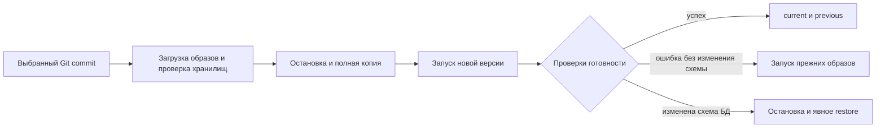

# Установка и обновление FCPLCn

`install.sh` разворачивает **FCPLCn — Future City PLC Next** как локальный
хаб или облачный сервер. `update.sh` обновляет выбранную установку. Node.js,
PostgreSQL и зависимости приложений входят в контейнеры.

Скачайте официальный репозиторий на хаб или VPS и запустите установщик:

```sh
git clone https://github.com/LittleBuster/fcplcn-soft.git
cd fcplcn-soft
./install.sh
```

Для скачивания нужен Git. Остальные зависимости подготовит установщик.
Используйте полный репозиторий. Скриптам нужны каталог `deploy/`,
исходники `hub/` и `cloud/` и данные из `config/`.

У обоих скриптов одинаковое меню выбора роли.

```text
  1. cloud — облако / VPS
  2. hub   — локальный хаб
  0. Выход
```

После выбора `install.sh` запускает установку, а `update.sh` — обновление.
Для запуска с заданной ролью укажите её в явном виде, например `./install.sh hub`
или `./update.sh cloud`. Копии, откат, журналы и остальные команды обслуживания
доступны через `./deploy/manage.sh`.

Команды выполняются из корня `fcplcn-soft`. Если архив исходников не сохранил
право на исполнение, используйте `bash install.sh` или `bash update.sh`.

## Поддерживаемые машины

| Машина / ОС                                         | Роль          | Контейнеры                | Особенности                                                |
| --------------------------------------------------- | ------------- | ------------------------- | ---------------------------------------------------------- |
| Debian 13 Trixie, x86-64                            | hub или cloud | `linux/amd64`, Node.js 24 | Docker Engine и Compose из официального apt-репозитория    |
| Debian 13, ARM64                                    | hub или cloud | `linux/arm64`, Node.js 24 | Тот же установщик                                          |
| Armbian, Orange Pi Zero 3, Allwinner H618, 1 ГБ RAM | hub           | `linux/arm64`, Node.js 24 | Только 64-битная ОС; готовый образ из GHCR                 |
| macOS, Apple Silicon, включая M5                    | hub           | `linux/arm64`, Node.js 24 | Docker Desktop либо уже работающий локальный Docker engine |

Поддерживаемые базы Armbian: Debian 12 Bookworm / 13 Trixie и Ubuntu
22.04 Jammy / 24.04 Noble / 26.04 Resolute / 26.10 Stonking. Проверяется
`/etc/os-release`, для производных Ubuntu учитывается `UBUNTU_CODENAME`.
Нужен образ Armbian с работающими cgroups, сетью и ядром, пригодным для Docker.
Установка Docker не исправляет несовместимое ядро платы.

Целевая плата хаба — **Orange Pi Zero 3, Allwinner H618, 1 ГБ RAM**.
Установите 64-битный Armbian. **32-битный ARM не поддерживается**: установщик
отклоняет и 32-битный процессор, и 32-битный userspace на 64-битном ядре.
Хаб, облако и среда разработки используют **Node.js 24**.

На плате с 1 ГБ RAM используйте готовый образ из GitHub Container Registry:
компиляция TypeScript и веба проходит в GitHub Actions. Если на Linux меньше
1,5 ГБ RAM, неявная локальная сборка отклоняется с подсказкой указать `--repo`
или `--image`. Явный `--source-build` остаётся вариантом разработчика и может
не поместиться в память платы. Для нагрузки с большим количеством PLC, сценариев
и одновременно открытых редакторов проверьте расход памяти на реальной системе.

На macOS используется обычный Linux ARM64-контейнер; отдельной сборки для M5
не требуется. Docker Desktop требует поддерживаемую версию macOS и минимум
4 ГБ RAM. Для нативных ARM64-образов устанавливать Rosetta не нужно.

## Что установщик делает с системой

На Linux устанавливает отсутствующие Git, Python 3.10+, curl, OpenSSL, tar,
корневые сертификаты и средства работы с apt-ключами. При отсутствии Docker
добавляет его официальный подписанный репозиторий и устанавливает Engine,
CLI, containerd, Buildx и Compose plugin. Служба Docker включается при загрузке.

Работающий Docker повторно используется. Установщик не удаляет другой контейнерный
движок и его данные. Для существующего Docker CE при необходимости устанавливает
Compose plugin; для стороннего движка сообщает, если Compose слишком старый.
Требуется **Compose не ниже 2.24.4**. Пользователь автоматически не добавляется
в группу `docker`: если к Linux-демону нужен `sudo`, установщик использует его
для Docker-команд.

На Mac сначала используется установленный Docker. На чистой машине при
необходимости устанавливаются Homebrew, Python и Docker Desktop. Установка
Apple Command Line Tools и первый запуск Desktop могут потребовать действий
в окне macOS: установщик сообщает об этом, после завершения его можно запустить
повторно. `--yes` не принимает условия Docker Desktop за пользователя.
На Mac запускайте установщик **без `sudo`**.

Удалённые Docker contexts (`ssh://`, `tcp://`) отклоняются: исходники,
постоянный каталог и Docker должны находиться на той машине, где идёт установка.
Rootless Docker и локальный Unix socket Docker Desktop допускаются.

Проверить план и систему без установки:

```sh
./install.sh hub --dry-run
./update.sh hub --dry-run
./deploy/manage.sh hub doctor
```

`--dry-run` ничего не устанавливает и не создаёт каталогов. `doctor` проверяет
уже установленный Docker; на Linux при отсутствии доступа к сокету запустите
его через `sudo`. Эти команды не проверяют физические датчики и PLC.

## Установка хаба

Если исходники уже скачаны:

```sh
./install.sh
```

Выберите **2 — hub**.

На amd64/arm64 без GitHub origin образ будет собран локально. Если исходники
получены из чистого Git checkout с GitHub origin, выбирается готовый образ того
же commit. Для Zero 3 с 1 ГБ нужен опубликованный образ — см. раздел GitHub ниже.

Явно выбрать GitHub-репозиторий и ветку:

```sh
./install.sh hub \
  --repo https://github.com/LittleBuster/fcplcn-soft.git \
  --ref main
```

Адрес выше указывает на официальный репозиторий FCPLCn. Для собственного fork
укажите его GitHub URL; перед установкой дождитесь публикации образов из этого fork.
Установщик также читает софт во вложенной папке `fcplcn-soft`. Приведённый
workflow рассчитан на отдельный репозиторий с софтом в корне; для вложенного
варианта отдельно адаптируйте пути workflow и build context.

После готовности откройте **`http://IP-ХАБА:3000`**. Первый вход: **`admin`**,
пароль пустой. Изменение учётной записи в вебе сохраняется между обновлениями.
Локальный MQTT опубликован на **1883/TCP**, веб — на **3000/TCP**.
PostgreSQL хаба разворачивается автоматически и доступен внутри Compose.
Для его данных используется том `hub-db-data`.

Создать отдельную MQTT-учётную запись контроллера:

```sh
./deploy/manage.sh hub plc --plc-id fcplcn-DEVICE_ID
```

Укажите фактический `deviceId` из статуса PLC. Команда явно показывает созданный
пароль. В сервисном вебе PLC, вкладка **«Хаб»**, задайте LAN-адрес хаба, порт 1883,
этот логин и пароль. Пароль хаба для подключения PLC использовать не нужно.
Повторный вызов `plc` для того же ID меняет его пароль — обновите его и на PLC.

На Mac указывайте **LAN-адрес Mac**, не адрес контейнера и не `localhost`.
Разрешите Docker доступ к локальной сети в настройках macOS, если система
запросит его. Проверьте входящие подключения firewall, включите запуск Desktop
при входе пользователя и исключите сон Mac на время работы хаба. Docker Desktop
должен работать, а пользовательская сессия — быть запущена. Для постоянно
включённого хаба Linux обычно удобнее.

## Установка облака

Подготовьте VPS с Debian 13 amd64/arm64 и свой домен. Направьте A/AAAA домена на
сервер; публикуйте AAAA только при работающем IPv6. Откройте порты 80/TCP,
443/TCP, 443/UDP и 8883/TCP. PostgreSQL наружу не публикуется.

```sh
./install.sh
```

Выберите **1 — cloud**.

В интерактивном режиме установщик спросит домен, если он не передан. В режиме
`--yes` домен нужно задать явно. При желании добавьте `--repo` и `--ref`, как для
хаба. Начальная подготовка создаёт разные случайные пароли, ключ приложения,
CA и сертификат MQTT. Секреты не выводятся в обычный журнал установки.

Откройте **`https://cloud.example.com`**. Первый вход: **`admin`**, пароль пустой;
измените учётную запись в веб-панели. Создайте дом и код подключения. В локальной
панели хаба на странице **«Облако»** введите HTTPS-адрес и код. PLC остаются
подключёнными только к локальному MQTT и не получают облачные пароли.

Caddy сам получает и продлевает публичный HTTPS-сертификат. Сертификат MQTT
проверяется/обновляется при подготовке развёртывания. Для управляемой установки
раз в месяц выполняйте команду с прежним `--dir`, если он был задан:

```sh
./deploy/manage.sh cloud certificates
```

Она сохраняет копию, повторяет подготовку ключей с прежним CA и перезапускает
службы. Сертификат MQTT перевыпускается, когда до истечения осталось меньше
30 дней. Обычный `update` без изменений не выполняет обслуживание сертификата.
При rootless Docker публикация портов ниже 1024 может требовать заранее
настроенного перенаправления; установщик не меняет глобальные параметры ядра.

## Постоянные данные и файлы

Каталог установки выбирается отдельно от исходников:

| Запуск                         | Каталог по умолчанию                                          |
| ------------------------------ | ------------------------------------------------------------- |
| Linux от root                  | `/opt/fcplcn/hub` или `/opt/fcplcn/cloud`                     |
| Linux от обычного пользователя | `~/.local/share/fcplcn/hub` или `~/.local/share/fcplcn/cloud` |
| macOS                          | `~/Library/Application Support/FCPLCn/hub` или `.../cloud`    |

Можно указать `--dir /путь/к/установке`; затем указывайте **тот же путь** во всех
командах. Запускайте обслуживание от того же пользователя. Не переключайтесь
между обычным запуском и `sudo` без явного `--dir`: это разные каталоги установки.
Пути с пробелами и кириллицей поддерживаются.

```text
<каталог установки>/
├── metadata.json           роль, архитектура, домен, проект и порты
├── runtime/                постоянные настройки и MQTT-полномочия
├── releases/<версия>/      отдельный снимок исходников и Compose override
├── current -> releases/…   текущая успешно запущенная версия
├── previous -> releases/…  предыдущая успешно запущенная версия
└── backups/<дата-версия>/  полные согласованные копии
```

Данные приложения лежат в именованных Docker volumes. По умолчанию проект хаба
называется `fcplcn`: volumes `fcplcn_hub-data` и `fcplcn_broker-data`. Проект облака
— `fcplcn-cloud`, его шесть volumes перечислены в [cloud/DEPLOY.md](../cloud/DEPLOY.md#хранение-и-права).
Имена проектов и volumes не меняются при обновлении.

Если найдены volumes прежней ручной установки без метаданных установщика,
автоматическая подмена отклоняется. Сначала сохраните прежние данные и выполните
планируемый перенос либо выберите отдельный `--project` и свободные порты. Новый
проект — отдельный экземпляр, а не автоматическая миграция прежнего.

## Обновление после изменений на GitHub

В репозитории есть [GitHub Actions workflow](../.github/workflows/container-images.yml).
После push он собирает хаб для amd64/arm64 и облако для amd64/arm64,
проверяет хаб на целевой среде и публикует объединённые образы:

```text
ghcr.io/littlebuster/fcplcn-hub:sha-<полный commit SHA>
ghcr.io/littlebuster/fcplcn-cloud:sha-<полный commit SHA>
```

Также публикуются `latest` для основной ветки, имена веток и версии для тегов
`v*`. Для обновления установщик выбирает конкретный commit, а не плавающий
`latest`. Объединённый SHA-образ появляется после успеха всех архитектур.

Официальные образы публикуются из
[LittleBuster/fcplcn-soft](https://github.com/LittleBuster/fcplcn-soft).
Перед установкой выбранного commit дождитесь успешного workflow
**FCPLCn container images**. Публичные образы GHCR скачиваются без входа в registry.

Для собственного fork:

1. Разместите софт в корне своего GitHub-репозитория и разрешите GitHub Actions.
2. Разрешите публикацию packages для workflow и дождитесь успешной сборки.
3. В `--repo` укажите GitHub URL своего fork. Имя владельца для GHCR определяется
   автоматически и переводится в нижний регистр: `ghcr.io/владелец/fcplcn-hub`
   и `ghcr.io/владелец/fcplcn-cloud`.
4. Сделайте пакеты публичными для скачивания без авторизации. Если fork или его
   образы приватные, настройте Git-доступ и выполните `docker login ghcr.io` на сервере.
   Для Linux с доступом к Docker через sudo используйте `sudo docker login ghcr.io`.
   Токены в `--repo` не допускаются.

Для обновления запустите отдельный скрипт:

```sh
./update.sh
```

Выберите **1 — cloud** или **2 — hub**. Скрипт использует уже установленные
Git, Python и Docker, сохранённый адрес репозитория и настройки выбранного
экземпляра. Для обновления установки, созданной предыдущим скриптом, запустите
`update.sh` из актуальной копии репозитория. Если при установке задавали свой
каталог, передайте тот же `--dir`.

Если изначально у исходников не было GitHub origin:

```sh
./update.sh hub --repo https://github.com/LittleBuster/fcplcn-soft.git --ref main
```

Порядок обновления:



Работающая версия остаётся доступной, пока скачиваются исходники и образы.
На хабе обновляются приложение, Mosquitto и локальный PostgreSQL. В облаке обновляются приложение,
PostgreSQL, Mosquitto и Caddy. Версии служебных образов берутся из Compose
выбранного релиза. Скрипт проверяет эти образы и при повторном обновлении
того же коммита. На время копирования и перезапуска веб-сервисы недоступны,
а автономная логика PLC остаётся на контроллерах.

Если GitHub недоступен или один из нужных образов отсутствует, скрипт завершится,
а текущая версия останется в работе. Обновление также останавливается до перезапуска,
если меняется подключение существующего постоянного хранилища, основная версия
PostgreSQL или его каталог данных (`PGDATA`). Для таких изменений нужен отдельный
перенос данных.

Обычные обновления не трогают рабочую копию Git. Чтобы пользоваться обновлённым
кодом самого установщика, следующий вызов можно выполнять из
`<каталог установки>/current/source/update.sh`, передавая прежний `--dir`.
Старые снимки, образы и копии автоматически не удаляются: контролируйте свободное
место и храните важные копии отдельно от диска хаба/VPS.

Явные варианты для разработчика:

```sh
./install.sh hub --source-build
./install.sh hub --image ghcr.io/littlebuster/fcplcn-hub:latest
./update.sh hub --ref v1.0.0
```

`--source-build` сознательно включает локальную сборку, в том числе на Zero 3.
На плате с 1 ГБ она может не поместиться в память. `--image` — явный выбор
оператора: он отвечает за соответствие образа выбранным исходникам и Compose.

### Сохранение настроек при обновлении

`update.sh` сохраняет постоянные данные выбранной установки.

- учётные записи хаба и облака, изменённые логины и пароли;
- имена устройств, сценарии и расписания;
- учётные данные MQTT, настройки Telegram-бота и разрешённые chat ID;
- ключи и привязки хаба к облаку;
- почасовую историю метеодатчиков в PostgreSQL на хабе;
- данные PostgreSQL в облаке, включая пользователей, дома, права и журнал действий.

Постоянные настройки находятся в `runtime/` и именованных Docker-томах.
Новая версия подключает прежние тома и использует существующие файлы настроек
из `runtime/`. Перед обновлением скрипт сохраняет исходники текущего релиза,
`runtime/`, все тома и точные образы его служб. Новый релиз также запоминает
точные идентификаторы образов для отката.

Обычное обновление не сбрасывает учётные записи: `admin` с пустым паролем
создаётся только при первом запуске новой установки.

При обновлении с файлового хранилища хаб получает отдельный том PostgreSQL
и случайные пароли базы. После резервной копии новая версия переносит учётную
запись, Telegram и SQLite-историю до запуска веб-интерфейса. Исходные файлы
сохраняются. Возврат к версии с файловым хранилищем выполняется через
`restore` из копии, созданной перед переходом.

## Копии, откат и восстановление

```sh
./deploy/manage.sh hub backup
./deploy/manage.sh hub rollback --yes
./deploy/manage.sh cloud backup
./deploy/manage.sh cloud restore --backup /путь/к/каталогу/копии --yes
```

`backup` архивирует исходники, настройки, тома и записанные в релизе Docker-образы.
Чтобы согласованно скопировать данные, скрипт останавливает все службы
выбранной установки, включая PostgreSQL, и затем запускает их снова. В копиях
старых релизов может храниться только образ приложения.

`rollback` сначала сохраняет копию и запускает образы предыдущего релиза
с текущими данными. Если менялись SQL-миграции облака, для возврата к старой
схеме используется полное `restore` соответствующей копии.

`restore` проверяет manifest, контрольные суммы, пути архивов, роль, проект и
архитектуру. Перед заменой данных работающей установки сохраняется ещё одна
копия текущего состояния. Без `--yes` запрашивается явное подтверждение.
Данные будут заменены содержимым копии; автоматического отката базы после
неудачной миграции нет. Если само восстановление оборвалось, повторите его
с целой копией до запуска приложения. Если закреплённого образа нет локально,
скрипт загрузит его из копии. При восстановлении из старой копии с одним образом
приложения остальные образы должны быть доступны локально или в реестре.
Физическая копия базы рассчитана на ту же архитектуру и совместимую версию PostgreSQL.

Копии содержат секреты. Каталог закрывается правами `0700`, файлы — `0600`;
архивы не шифруются самим установщиком. Для хранения вне сервера выбирайте
закрытое хранилище с шифрованием. `down --volumes` и глобальный `docker prune`
установщик не выполняет.

## Обслуживание и несколько экземпляров

```sh
./deploy/manage.sh hub status
./deploy/manage.sh hub logs --follow
./deploy/manage.sh cloud status
./deploy/manage.sh cloud logs
```

Для отдельного тестового экземпляра:

```sh
./install.sh hub --dir "$HOME/fcplcn-test" \
  --project fcplcn-test --http-port 13000 --mqtt-port 11883
```

Установщик запоминает проект и порты. К последующим командам добавляйте тот же
`--dir`. У облака также есть `--https-port`; домен и имя уже существующего проекта
не меняются обычным обновлением. Состояние устанавливается вне дерева исходников.

Ручной запуск Compose по-прежнему возможен. Для установки, созданной этим
скриптом, используйте его команды обслуживания: он подставляет постоянный
runtime и точный образ. Команда Compose без этих
параметров может выбрать другой экземпляр или другой образ.

## Проверки и границы проверки

```sh
python3 -m unittest discover -s deploy/tests -v
for script in install.sh update.sh deploy/*.sh deploy/platform/*.sh; do
  bash -n "$script" || exit
done
```

Автотесты проверяют выбор платформы, безопасный предварительный просмотр,
Git-снимки, секреты, блокировки и отказоустойчивость операций с подменённым
исполнителем Docker. Дополнительно контейнеры проверяются реальными сборками
и запуском, включая ARM64. Эмуляция не подтверждает работу ядра,
SD-карты и доступной памяти конкретного Orange Pi. Чистая установка пакетов
на физические Orange Pi, Debian и Mac M5 должна проверяться на этих машинах.

Источники для поддержки платформ:
[Docker на Debian](https://docs.docker.com/engine/install/debian/),
[Docker на Ubuntu](https://docs.docker.com/engine/install/ubuntu/),
[Armbian: выбор образа](https://docs.armbian.com/getting-started/choosing-an-image/),
[Docker Desktop на Mac](https://docs.docker.com/desktop/setup/install/mac-install/),
[Docker Desktop: локальная сеть](https://docs.docker.com/desktop/troubleshoot-and-support/troubleshoot/topics/#containers-cant-reach-devices-on-my-local-network),
[официальные образы Node.js](https://github.com/docker-library/official-images/blob/master/library/node),
[сроки поддержки Node.js](https://github.com/nodejs/Release/blob/main/schedule.json).
