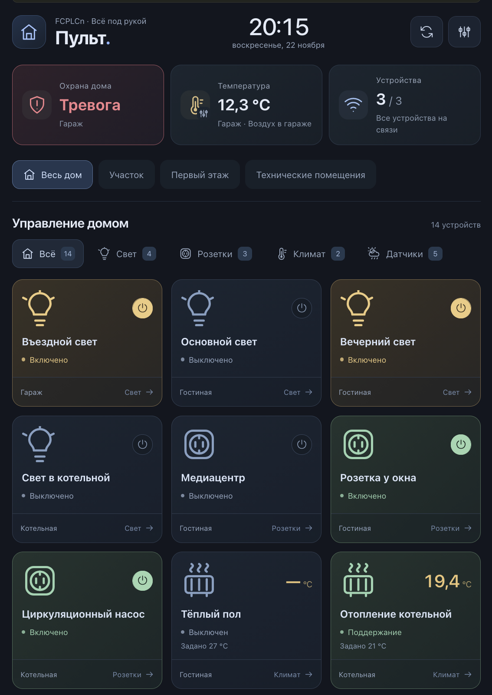

# FCPLCn Hub

Локальный хаб **FCPLCn — Future City PLC Next** для Linux mini PC. Сервер написан
на TypeScript для Node.js 24, веб-панель — на TypeScript/Preact. PLC обнаруживаются
по сообщениям локального MQTT-брокера. Браузер общается с сервером хаба, а сервер
отправляет адресованные команды контроллерам.

## Запуск на этом компьютере без оборудования

Из корня проекта:

```sh
cd hub
npm ci
npm run demo
```

Открыть [http://127.0.0.1:3000](http://127.0.0.1:3000). Войти с логином `admin`,
пароль оставить пустым. Демо использует виртуальные PLC, не подключается к MQTT
и не переключает физические выходы.

## Пульт для планшета

[](../docs/readme/hub-pult.png)

Откройте **«Пульт»** в меню или сохраните прямую ссылку
`http://адрес-хаба:3000/#pult`. Она открывает отдельную домашнюю страницу с часами,
состоянием охраны, температурой и крупными плитками света, розеток, климата, датчиков и баков.
Кнопка **«Панель хаба»** возвращает полную навигацию и настройки.

Вкладку **«Сценарии»** можно открыть напрямую по адресу `http://адрес-хаба:3000/#pult/scenes`.
Касание плитки в группе **«Мгновенные»** запускает сценарий один раз. В группе
**«По расписанию»** касание включает или выключает автоматические запуски хаба.
Подсвеченная плитка означает, что расписание включено. Выключенное расписание
остаётся в той же группе и сохраняет дни, время и часовой пояс.

На карточке **«Температура»** нажмите значок настройки и выберите контроллер и датчик.
Выбор сохраняется в хабе в `FCPLCN_HUB_DATA_DIR/pult.json` и используется всеми
планшетами, включая облачную панель. При недоступности выбранного датчика остаются
его имя и прочерк вместо температуры; другой датчик автоматически не подставляется.
В облаке менять эту настройку может владелец дома.

В локальном **«Пульте»** карточка **«Устройства»** открывает **«Графики связи»**.
Можно посмотреть все контроллеры на общей шкале или выбрать один PLC за **24 часа**
или **7 дней**. После закрытия графика остаются выбранные помещение и фильтр.

Оборудование берётся из текущего снимка PLC; доступны фильтры помещений и типов устройств.
Плитка изменяет состояние после подтверждения PLC. При потере свежей связи управление
блокируется, а после пробуждения планшета или восстановления сети хаб запрашивается заново.
Локальный вход сохраняется после перезапуска хаба и не имеет прежнего 12-часового ограничения.

Проверка страницы и восстановления после сна: `node hub/tests/pult.browser.cjs`
из корня репозитория после `npm --prefix hub run build`. Она также включена в
полный `npm --prefix hub run test:browser`.

## Баки с водой

Модуль **«Баки»** настраивается через встроенный редактор PLC. В каждом баке
выбираются от одного до трёх цифровых входов по порядку снизу вверх; по умолчанию
предлагаются два — нижний и верхний. Замкнутый контакт означает наличие воды.
Можно назначить реле насоса откачки и реле крана наполнения; пустое назначение
позволяет использовать только измерение уровня.

Автоматика исполняется на PLC: насос включён, пока нижний датчик находится в воде,
а кран открыт, пока вода не достигла выбранного датчика наполнения. Эти выходы
работают независимо. Отключение мониторинга или ошибка датчиков выключают оба
выхода. После перезапуска выходы заново вычисляются по проверенным входам.

Уровень отображается как дискретная оценка по датчикам: два датчика дают
**0 / 50 / 100 %**, три — **0 / 33 / 67 / 100 %**. Сочетание «верхний мокрый,
нижний сухой» показывает неисправность вместо вымышленного процента.

На странице PLC, в хабе, облаке и «Пульте» цилиндрический SVG-бак заполняется
голубой водой по подтверждённому уровню. Доступны состояния датчиков, насоса и
крана и явное включение/отключение мониторинга. При потере свежей связи показание
становится неизвестным, а управление недоступно. Сценарии и Telegram также могут
менять разрешение мониторинга, сохраняя местную автоматическую логику PLC.

## Полив по расписанию

Откройте **Пульт → Полив**. Для первого правила выберите PLC в пустом списке и нажмите **Добавить правило** в редакторе. У каждого правила своя плитка с днями недели, временем начала и длительностью. Нажатие на плитку включает или выключает её расписание. Кнопка **Настроить** внизу открывает это правило на PLC. К списку всех правил также можно перейти через **Контроллеры → нужный PLC → Полив**.

Выберите реле крана. Чтобы поливать по таймеру, оставьте в списке баков **«Без бака»**. В списке есть баки этого PLC и баки других PLC, которые передаёт хаб. Контроллер полива проверяет показания нижнего датчика выбранного бака. При опустошении бака или потере показаний кран закроется. На пульте различаются ожидание старта, активный полив и отсутствие воды. [Как PLC управляет поливом](../docs/architecture/IRRIGATION.md).

## Подключение реальных PLC

При ручном запуске нужны Node.js 24, локальный MQTT-брокер и отдельная база
PostgreSQL для хаба. Скопировать `.env.example` в `.env`, заполнить учётную запись
брокера и `FCPLCN_HUB_DATABASE_URL`. Штатный установщик готовит обе службы
автоматически. Для доступа из LAN установить
`FCPLCN_HUB_HOST=0.0.0.0`. По умолчанию логин веб-панели — `admin`, пароль пустой.
Вход требуется и при пустом пароле. Пароли хаба и MQTT — разные настройки.

У локального входа нет 12-часового ограничения: сессия остаётся действующей до
явного выхода или изменения учётной записи, включая перезапуск хаба. Это позволяет
оставить планшет на странице «Пульт». Cookie имеет длительный браузерный срок и
обновляется раз в сутки при активности; очистка данных браузера потребует нового входа.
Сроки входа в облачную панель этим не меняются.

Хаб хранит в `FCPLCN_HUB_DATA_DIR/sessions.json` только хэши токенов сессий,
привязанные к текущей учётной записи. Файл записывается атомарно с правами `0600`;
в нём нет самих токенов cookie. Повреждённый файл не заменяется пустым автоматически.

Логин и пароль изменяются на странице **Учётная запись** с подтверждением текущим
паролем; исходный пустой пароль также оставляется пустым. Флажок **Изменить пароль**
включает замену: от 8 символов либо пустое значение. Без флажка сохраняется прежний
пароль. После изменения все веб-сессии закрываются, требуется новый вход.

Рабочий хаб хранит учётную запись в PostgreSQL. В базе записываются логин, соль
и хеш пароля. При первом запуске с новой базой переносится существующая запись
из `credentials.json`. `FCPLCN_HUB_PASSWORD` задаёт начальный пароль, если учётная
запись ещё отсутствует и переносить нечего. Данные сессий остаются в
`sessions.json`, а прежние сессии сохраняют привязку к импортированной записи.

```sh
npm ci
npm run build
npm start
```

На каждом PLC во вкладке **Хаб** указать LAN-адрес Linux mini PC, порт брокера
`1883`, MQTT-логин и пароль. Для приведённой ниже конфигурации брокера логин PLC
должен совпадать с его `deviceId`; этот идентификатор не меняется при переименовании.
После подключения PLC появится в панели автоматически. Имя и комнату можно
задать в хабе.

После запуска или восстановления MQTT хаб ожидает новые сообщения PLC. Старый
retained-снимок можно показать для справки, но он не разрешает управление.

## Что уже доступно

- Обзор PLC, состояние связи, комнаты, поиск и индивидуальные страницы устройств.
- Розетки и свет: явные команды включения/выключения.
- Метео: показания и доступность локальных датчиков.
- Термостаты: показ состояния и включение/выключение настроенного регулятора.
- Охрана: постановка/снятие, зоны и тревога.
- Баки: дискретный уровень воды, автоматическая откачка и наполнение, управление мониторингом.
- Сценарии «Я дома», «Ушел» и «Готовлюсь», собственные сценарии и запуск по расписанию.
- Подтверждения команд, состояния ожидания, отказа и неизвестного результата.
- Тёмный адаптивный интерфейс с SVG для PLC, оборудования и тревоги.
- Полная панель «Настроить PLC»: назначение портов, создание и удаление элементов,
  поиск OneWire/iButton, сеть, часы, профиль платы, пользователь и резервная копия.
- Отдельная страница «Облако»: привязка к своему VPS, состояние исходящего
  соединения, отключение и удаление привязки.

Хаб использует MQTT-контракт прошивки, включая частный канал настройки.
Условные сценарии по датчикам относятся к следующим этапам. Облачная панель
реализована в [`cloud/`](../cloud/README.md).
Хаб не переносит термоконтроль на Node.js: автономные циклы
всегда исполняются на соответствующем PLC и продолжаются без хаба.

## Картинка устройства

Откройте карточку PLC и нажмите **Картинка**. В каталоге доступны 30 SVG:
контроллер, гараж, котельная, помещения, участок и оборудование. Найти подходящую
можно поиском или фильтром категории. Выберите изображение и нажмите
**Сохранить картинку** — оно появится на общей карточке и странице устройства.

Выбор хранится вместе с именем и помещением в `FCPLCN_HUB_DATA_DIR/devices.json`
и сохраняется после перезапуска. Изменение имени отдельно не сбрасывает картинку.
Облачная панель использует этот же выбор; менять его может владелец дома.
Картинка относится к оформлению карточки, аппаратный профиль и настройки PLC
остаются прежними. Все изображения встроены в интерфейс и не загружаются извне.

## Настройка PLC через хаб

Открыть карточку PLC и нажать **Настроить PLC**. Встроена та же панель, что работает
на устройстве: розетки, свет, метео, термостаты, охрана, баки, аппаратная часть, сеть,
хаб, система и пользователь. Все её запросы проходят через хаб и MQTT; браузеру
не нужен прямой HTTP-доступ к IP устройства. Достаточно входа администратора хаба.
Смена учётной записи самого PLC по-прежнему требует его текущий пароль.

Изменение получает статус сохранённого только после ответа PLC. Устройство само
проверяет ревизию, занятость портов, безопасное выключение выходов и запись в NVS/FRAM.
Черновики открытой формы не заменяются опросом статусов и сохраняются при потере связи.
Отмена ещё не отправленного запроса удаляет его из ограниченной очереди; отправленная
операция без ответа имеет неизвестный результат и автоматически не повторяется.
После такого случая следует загрузить актуальные настройки PLC перед повторным сохранением.

Порты `rly-0/…`, `in-0/…` и `sens-0/…` выбираются из активного аппаратного профиля.
Физическая распиновка остаётся в проверенных профилях прошивки. Выбор другого
зарегистрированного профиля применяется после перезагрузки; несовпадающий профиль
резервной копии отклоняется устройством.

Для реального PLC требуется новая прошивка с `managementVersion: 1` в heartbeat.
Старое устройство продолжает передавать состояния и принимать обычные команды;
панель предложит обновить прошивку для настройки. Образы создаёт
`tools/firmware/build-base` в `firmware/base/dist/`.

Канал настройки доверяет правам локального брокера: PLC читает только собственные
запросы и публикует собственные ответы, администраторский процесс хаба имеет доступ
ко всем PLC. После обновления файлов брокера повторить шаг `broker-setup hub` и
перезапустить брокер, чтобы добавить права `management/request` и `management/reply`;
скрипт сохраняет остальные учётные записи.

### Обновление прошивки из браузера

В панели **Настроить PLC → Система** можно выбрать файл приложения `FCPLCn.bin` и
загрузить его в устройство. Та же форма доступна в локальной веб-панели самого PLC.
Объединённый `FCPLCn-full.bin`, загрузчик и образы другого проекта/чипа не подходят.
Для появления этой возможности на старом устройстве сначала нужна однократная
прошивка версии с поддержкой OTA через USB.

В хабе файл передаётся ограниченными блоками через приватный MQTT-канал настройки;
прямой HTTP-доступ к PLC не требуется. Бинарник не сохраняется в хабе, журналах или
очереди команд. Перед переключением загрузочного раздела PLC проверяет размер,
тип приложения, целевой чип и SHA-256. Запись идёт в неактивный OTA-раздел;
прерванная передача не заменяет работающую прошивку. При потере связи загрузка
автоматически не повторяется: незавершённый сеанс истекает через 60 секунд.

Во время загрузки автономные контроллеры продолжают работу. После принятия файла
PLC перезапускается; выходы на время запуска переходят через штатную безопасную
инициализацию, затем восстанавливается сохранённая логика. Конфигурация и FRAM не
стираются. Хаб приостанавливает запуск сценариев и ручные команды на время
обновления. Панель проверяет идентификатор нового образа и загрузочный раздел,
поэтому возврат к прежней прошивке не отображается как успешное обновление.

В демонстрации используется виртуальная проверка и перезагрузка PLC; прошивка
компьютера и физическое оборудование не изменяются.

## История метеодатчиков

Рабочий хаб хранит почасовые средние температуры и влажности за последние семь дней
в своём PostgreSQL. При переходе из `meteo-history.sqlite` переносятся накопленные
средние вместе со счётчиками и отметками последнего показания. Для среднего
берётся до одного свежего измерения каждого датчика в минуту. График показывает
одну точку на час с показаниями и соединяет соседние точки прямыми отрезками.
На пропущенных часах линия прерывается. Текущий час отражает уже полученные измерения.

В карточках метеодатчиков на странице PLC и в «Пульте» кнопка **«График»**
открывает периоды **«24 часа»** и **«7 дней»**. В Telegram эти две кнопки есть
в карточке датчика, а график приходит картинкой в чат. В режиме демонстрации
графики сразу доступны с тестовыми показаниями в отдельной базе SQLite.
Демонстрация запускается без PostgreSQL и не использует рабочую базу.

## Telegram

В меню хаба есть отдельная страница **Telegram**. Бот работает на Linux-хабе через
исходящие HTTPS-запросы к официальному Bot API; публичный адрес и входящий порт
для него не нужны. PLC продолжают работать только с локальным MQTT-брокером.

1. Создать бота у [BotFather](https://t.me/BotFather) и ввести полученный API-токен.
2. Включить бота и сохранить настройки. Кнопка проверки проверяет учётную запись
   бота без отправки сообщений людям.
3. Написать своему боту `/start` в личном чате. На странице хаба появятся Chat ID,
   имя и `@username` последнего написавшего, даже если доступ ему ещё не разрешён.
4. Нажать «Добавить» у этого человека или ввести Chat ID и имя вручную, затем
   сохранить разрешённый список. Обнаружение человека само по себе доступа не даёт.
5. Ещё раз отправить боту `/start`, чтобы получить клавиатуру управления после
   выдачи доступа.

Доступ определяется числовым Chat ID личного чата. Имена и `@username` нужны для
удобства и могут меняться; их изменение не передаёт доступ другому пользователю.
Удаление человека из списка сразу прекращает обработку его следующих команд.

В HTML-сообщениях бот выделяет заголовки, результаты команд и технические данные.
Кнопки клавиатуры отмечены эмодзи. В первом ряду доступны
«Я дома», «Ушел» и «Готовлюсь». Ниже находится список PLC. После выбора PLC бот
открывает его модули и каналы. В главном меню видны общий режим охраны и
число подтвердивших его PLC. Мгновенные сценарии запускаются из списка.
У сценария по расписанию можно приостановить или включить будущие запуски,
а также выполнить его вручную.

| Модуль         | Доступно в Telegram                                                                                                                                 |
| -------------- | --------------------------------------------------------------------------------------------------------------------------------------------------- |
| Розетки и свет | Переключение каждого канала или всей группы. В подробностях видны реле, вход кнопки и подтверждённое состояние.                                     |
| Метео          | Температура, влажность, тип датчика, порт, возраст подтверждённого показания и графики за 24 часа или 7 дней.                                       |
| Термостаты     | Фактическая температура, работа реле и задержка переключения. Можно включить или выключить регулятор и изменить уставку, режим и гистерезис.        |
| Охрана         | Постановка и снятие, готовность, зоны, сирена и фазы задержек.                                                                                      |
| Баки           | Процент, датчики уровня, насос и кран. Можно переключить мониторинг и выбрать уровень закрытия крана наполнения.                                    |
| Полив          | Выбранный бак, наличие воды, подтверждение крана и остаток сеанса. Можно переключить правило и изменить дни, время, длительность или источник воды. |

Модуль можно включить и выключить в его меню **«Настройки»**, если PLC поддерживает
удалённую настройку. Для изменения параметра откройте канал, нажмите **«Настроить»**,
выберите параметр и подтвердите **«Сохранить»**. Бак для полива можно выбрать
из местных и удалённых баков либо оставить **«Без бака»**. Назначение портов,
регистрация ключей и обновление прошивки находятся в сервисной панели PLC.

Веб и Telegram используют общие ограничения текущего сценария, сохранения настроек
и OTA. Изменение подтверждается ответом PLC. Старые сообщения после запуска или
восстановления соединения пропускаются, команды и неизвестные результаты не
повторяются автоматически. Потеря интернета отключает бота, сохраняя локальный
веб, MQTT и автономную логику PLC.

Токен, список людей, сведения о последнем контакте и номер обработанного
сообщения рабочий хаб хранит в PostgreSQL. Существующие настройки переносятся из
`telegram.json` при первом запуске с новой базой. Веб-панель показывает только
признак наличия токена. Пустое поле сохраняет токен, удаление выполняется отдельным
явным действием. Пример клавиатуры на странице настроек работает локально.

Проверки выполняются с изолированным заменителем Bot API и виртуальными PLC;
реальный токен для `npm test` и `npm run test:browser` не требуется.

## Сценарии

На главной странице доступны три ручных сценария:

- **Я дома** — снять с охраны все известные хабу контроллеры охраны.
- **Ушел** — поставить их на охрану.
- **Готовлюсь** — выполнить выбранные действия без автоматического изменения охраны.

Разрешённая таблетка iButton на любом PLC запускает общий режим дома: одно новое
касание — «Я дома» или «Ушел», следующее отдельное касание — обратный режим.
Все известные хабу PLC участвуют автоматически; выбирать целевые устройства
списком не требуется. В охрану включаются настроенные активные модули, остальные
отмечаются отдельно. Удержание таблетки и повторная доставка одного события не
запускают дополнительные сценарии. Простое изменение состояния `armed` событием
касания не считается.

На обзоре и странице PLC с охраной есть один обновляемый статус **Охрана всего
дома**: текущий заданный режим, подтверждения и отстающие устройства. Отсутствующий
PLC не задерживает настроенные действия сценария, например переключение контактора
на другом PLC. После возвращения ему передаётся текущий режим охраны; старые
действия сценариев повторно не запускаются. При нескольких переключениях за время
отсутствия применяется только последний режим.

Подтверждение означает, что PLC принял заданный режим. Задержка на выход
показывается как постановка, время на вход — как время на снятие, тревога — красным.
Действия сценария не ждут окончания этих задержек.

В демонстрации на странице охраны PLC доступна кнопка **Приложить таблетку** с
меткой «Демо». Она проходит тот же путь события, что настоящий iButton. В облаке
кнопка доступна владельцу и пользователю с разрешением управления охраной.
Администратор брокера найдёт дополнительные MQTT-права и устройство протокола в
[deploy/SECURITY-SYNC.md](deploy/SECURITY-SYNC.md).

Отдельная страница **Сценарии** разделена на **Мгновенные** и **По расписанию**.
В ней можно создавать собственные сценарии, менять названия, действия и время
запуска. Для расписания выбираются дни недели, время и явный часовой пояс;
системный часовой пояс Linux не подменяет выбранную настройку. Сценарий с
расписанием также можно запустить вручную.

У каждого сценария есть настройки дополнительных действий: выбрать PLC, розетку,
светильник, термостат, бак или правило полива и явно задать «включить» либо «выключить». Например,
«Я дома» может включить свет, а «Ушел» — отключить розетки с подключёнными через
них контакторами. Контактор управляется как назначенная розетка/светильник PLC;
сценарий не обходит владельца реле и локальные ограничения. Действие термостата
меняет разрешение автономного регулятора, а не принудительно включает его реле.
Действие бака меняет разрешение мониторинга. Действие полива разрешает или приостанавливает выбранное правило. Днями, временем открытия крана и защитой по воде управляет сам PLC.
В собственных сценариях и «Готовлюсь» можно также явно поставить или снять
выбранную охрану. В «Я дома» и «Ушел» охрана управляется общим действием.

Результат отображается по каждому действию и PLC. Недоступное устройство,
отклонённая команда или неизвестный результат не превращаются в общий зелёный
успех. При частичном исполнении уже выполненные команды не откатываются
автоматически. Сценарии не ставятся в очередь на случай возвращения связи.

Настройки с проверкой версии и ограниченный журнал запусков сохраняются в
`scenes.json` внутри каталога данных. Перезапуск хаба не повторяет незавершённый
сценарий: такой запуск отмечается прерванным.

Планировщик заранее фиксирует попытку запуска в `scheduler.json`. Он не догоняет
пропущенное время после выключения, паузы, перевода часов или восстановления сети
и пропускает текущую минуту при запуске хаба. Повторный час при переходе с летнего
времени не запускает один сценарий дважды. Если другой сценарий выполняется,
следующий запуск помечается пропущенным и не ставится в очередь. Одновременные
действия следует объединять в один сценарий: совпадающие по времени сценарии
в этой версии не выполняются параллельно. Ошибка сохранения запрещает запуск и
отображается в диагностике планировщика. Расписания исполняются на Linux-хабе,
включая созданные из облачной панели; интернет для их запуска не требуется.
Условия по датчикам относятся к следующим этапам.

## Облако на своём сервере

Компонент [`cloud/`](../cloud/README.md) предоставляет HTTPS-панель пользователей,
домов, прав и удалённого управления. Порядок развёртывания с PostgreSQL, отдельным
облачным Mosquitto и Caddy — в [cloud/DEPLOY.md](../cloud/DEPLOY.md).
Для публичного доступа нужны ваш VPS и доменное имя; локальная сборка их не создаёт.

1. В облачной панели создать дом и получить код во вкладке **Подключение**.
2. В локальном хабе открыть **Облако**, ввести HTTPS-адрес сервера, код и имя хаба.
3. Дождаться состояния **На связи**. Во вкладке можно временно выключить соединение
   или явно удалить привязку. В облачной панели владелец также может отозвать хаб.

Без привязки внешнее соединение выключено. Хаб сам открывает исходящие HTTPS и
MQTT TLS-соединения; проброс портов домашнего роутера не нужен. Локальный и облачный
брокеры не объединяются прозрачным мостом. Индивидуальные отзываемые полномочия
хранятся в `FCPLCN_HUB_DATA_DIR/cloud.json` с правами `0600` и не возвращаются в браузер.
Повреждённый файл блокирует подключение и не удаляется автоматически.

Облачный владелец получает те же настройки PLC и подтверждения, что локальный
администратор. Роль «Пользователь» управляет оборудованием и запускает сценарии,
роль «Наблюдатель» только просматривает состояния. Управление охраной выдаётся
пользователю отдельно. Хаб повторно проверяет права и использует общий арбитр
ручных команд, сценариев, настроек и обновления прошивки.

На странице облака **Прошивка PLC** файл сначала загружается по HTTPS на сервер,
затем хаб скачивает его по одноразовому разрешению и передаёт PLC штатными блоками
локального MQTT-сервиса. Файл и целевой чип проверяются до активации. Устройство не
получает адрес облака или его ключи. Временные файлы хаба находятся в `cloud-ota/`
в каталоге данных и удаляются после завершения; прерванная установка не продолжается
автоматически. Обычная локальная форма обновления остаётся доступной.

При потере интернета локальный веб, MQTT, сценарии и расписания продолжают работу.
При потере самого хаба сохраняются автономные функции PLC. Команды привязаны к
свежему соединению и сроку; после переподключения старые действия не воспроизводятся.
Устаревшие сведения в облаке показываются отдельно от актуальных состояний.
Для локального HTTP-стенда предусмотрено явное
`FCPLCN_CLOUD_ALLOW_INSECURE_LOOPBACK=1`; рабочая привязка использует HTTPS и TLS.

## Установщик: Linux, Orange Pi и macOS

Из корня `fcplcn-soft`:

```sh
./install.sh
```

Выберите **2 — hub**. Для следующего обновления запустите `./update.sh`
и также выберите **2 — hub**.

Установщик готовит зависимости и Docker, разворачивает приложение и брокер
Mosquitto. `update.sh` обновляет оба контейнера, создаёт резервную копию
и сохраняет настройки и историю метеодатчиков. Целевая плата — Orange Pi Zero 3
с Allwinner H618, 1 ГБ RAM и 64-битным Armbian. На amd64 и arm64 используется Node.js 24.
32-битный ARM не поддерживается; на плате с 1 ГБ выбирайте готовый образ из GitHub.
На macOS Apple Silicon, включая M5, используется Docker Desktop или существующий
локальный Docker. Первая настройка Desktop может потребовать действий в его окне.

Полная инструкция, GitHub/GHCR, создание MQTT-учётных записей PLC и восстановление:
[deploy/README.md](../deploy/README.md). Ручная установка описана ниже; её данные
не подхватываются новым установщиком автоматически.

## Linux: Docker Compose

В Compose три сервиса — `hub`, `broker` и `db`. Веб-панель доступна на порту
`3000`, MQTT — на `1883`. PostgreSQL доступен внутри сети Compose, его данные
хранятся в томе `hub-db-data`. Подключение к VPS остаётся выключенным до явной
привязки на странице **Облако**.

1. В `hub/.env` задать `FCPLCN_HUB_MQTT_PASSWORD` не короче 8 символов и отдельные
   случайные значения для `FCPLCN_HUB_DATABASE_PASSWORD` и
   `FCPLCN_HUB_DATABASE_ADMIN_PASSWORD`. При запуске через `install.sh` пароли
   PostgreSQL создаются автоматически. MQTT-логин хаба по умолчанию — `fcplcn-hub`.
2. Из каталога `hub/deploy` подготовить учётную запись брокера и запустить сервисы:

```sh
docker compose --env-file ../.env --profile setup run --rm --no-deps broker-setup hub
docker compose --env-file ../.env up -d --build
docker compose --env-file ../.env logs -f hub
```

Открыть `http://IP_МИНИ_ПК:3000`. Войти как `admin` с начальным паролем хаба
(по умолчанию пустым).

Для каждого PLC добавить отдельную учётную запись. Следующий пример предназначен
для Bash на Linux: пароль вводится скрыто и не попадает в командную строку.
Вместо примера идентификатора подставить реальный `deviceId`:

```sh
read -r -s -p 'Пароль MQTT для PLC: ' FCPLCN_PLC_PASSWORD
printf '\n'
export FCPLCN_PLC_PASSWORD
FCPLCN_PLC_ID=fcplcn-001122334455 docker compose --env-file ../.env --profile setup run --rm --no-deps broker-setup plc
unset FCPLCN_PLC_PASSWORD
docker compose --env-file ../.env restart broker
```

В PLC указать его `deviceId` как MQTT-логин и только что заданный пароль.
Обновление учётной записи сохраняет остальные аккаунты. Файлы хешей и ACL лежат
в `deploy/runtime/broker/`, данные брокера и имена устройств хаба — в Docker volumes.
Каталог с хешами и volumes нужно включить в резервное копирование Linux mini PC.

Брокер запрещает анонимные подключения. ACL разрешает каждому PLC публиковать
свои состояния и подтверждения и получать только собственные команды. Учётная
запись хаба получает состояния всех PLC и отправляет им команды.
Подробности механизма: [Mosquitto ACL](https://mosquitto.org/man/mosquitto-conf-5.html),
[формат файла паролей](https://mosquitto.org/man/mosquitto_passwd-1.html).

## Linux: systemd без Docker

Пример службы — `deploy/fcplcn-hub.service`. Он предполагает:

- проект и собранный хаб в `/opt/fcplcn/hub`;
- Node.js 24 в `/usr/bin/node`;
- отдельного системного пользователя и группу `fcplcn`;
- настройки в `/etc/fcplcn/hub.env`, доступные только администратору;
- данные в `/var/lib/fcplcn`;
- уже настроенные Mosquitto с паролями и ACL и PostgreSQL с выделенной базой хаба.

После подготовки этих путей файл службы можно установить в
`/etc/systemd/system/fcplcn-hub.service` и включить через `systemctl enable --now
fcplcn-hub`. Служба запускает хаб, автоматически перезапускает его при сбое и
даёт запись только в каталог данных. Установка службы не выполняется командой
сборки или демо-запуском.

## Настройки

| Переменная                           | По умолчанию            | Назначение                                                  |
| ------------------------------------ | ----------------------- | ----------------------------------------------------------- |
| `FCPLCN_HUB_HOST`                    | `127.0.0.1`             | Интерфейс веб-сервера                                       |
| `FCPLCN_HUB_PORT`                    | `3000`                  | Порт веб-панели                                             |
| `FCPLCN_HUB_PASSWORD`                | пусто                   | Начальный пароль `admin`, только при первом запуске         |
| `FCPLCN_HUB_MODE`                    | `mqtt`                  | `mqtt` или `demo`                                           |
| `FCPLCN_HUB_MQTT_URL`                | `mqtt://127.0.0.1:1883` | Локальный брокер                                            |
| `FCPLCN_HUB_MQTT_USERNAME`           | пусто                   | MQTT-логин хаба                                             |
| `FCPLCN_HUB_MQTT_PASSWORD`           | пусто                   | MQTT-пароль хаба                                            |
| `FCPLCN_HUB_DATABASE_URL`            | пусто                   | Строка подключения к отдельной базе хаба при ручном запуске |
| `FCPLCN_HUB_DATABASE_PASSWORD`       | создаётся установщиком  | Пароль приложения для локального PostgreSQL в Compose       |
| `FCPLCN_HUB_DATABASE_ADMIN_PASSWORD` | создаётся установщиком  | Пароль администратора PostgreSQL для инициализации базы     |
| `FCPLCN_HUB_DATA_DIR`                | `./data`                | Каталог постоянных данных                                   |

Compose задаёт сетевые адреса и каталог данных внутри контейнеров самостоятельно;
`FCPLCN_HUB_BIND` и `FCPLCN_MQTT_BIND` управляют интерфейсами публикации портов.

### Переход со старого хранилища

`update.sh` делает копию прежнего хаба, создаёт том PostgreSQL и запускает новую
версию. Хаб переносит данные до открытия веб-интерфейса. Каждая часть переноса
завершается транзакцией и отмечается в новой базе, поэтому рестарт использует
уже перенесённые данные. Исходные файлы остаются в каталоге хаба. Для возврата
к версии с хранением в файлах нужна полная копия, сделанная перед переходом.

## Протокол и сохранение

Хаб подписывается на `fcplcn/+/availability`, `fcplcn/+/system/status`, состояния
и подтверждения пяти модулей в `fcplcn/+/controllers/…`.
Оперативная команда идёт в `fcplcn/<deviceId>/controllers/<module>/set`:

```json
{
  "id": "outlet-1",
  "value": true,
  "bootId": "идентификатор-текущей-загрузки-PLC",
  "sequence": 17,
  "expiresAtUptimeMs": 123000
}
```

Для охраны `id` всегда равен `alarm`. Для термостата `value` меняет его разрешение
работы, а не принудительно включает нагрев/охлаждение. Для бака `value` меняет
разрешение мониторинга. Для `irrigation` поле `id` указывает правило, а `value` разрешает или приостанавливает полив по расписанию. Команды не являются
`toggle`, не используют retain и не накапливаются для повторной отправки после
переподключения. Успех означает подтверждение PLC, а не только доставку брокеру.
При тайм-ауте результат считается неизвестным. В объекте должен работать один
активный хаб, отправляющий команды: автоматического выбора резервного хаба нет.

Частный сервис использует `fcplcn/<deviceId>/management/request` и
`fcplcn/<deviceId>/management/reply`. Запрос содержит `schemaVersion: 1`, уникальный
`requestId`, текущий `bootId`, независимый монотонный `sequence`, срок
`expiresAtUptimeMs`, `method`, относительный `path` и необязательный объект `body`.
Ответ повторяет идентификаторы и содержит HTTP-подобный `status` и исходный `data`
(объект или массив). Запрос ограничен 40 КиБ, ответ — 64 КиБ. Команды и ответы
не используют retain; отключение отменяет очередь. На PLC сборка фрагментов и очередь
ограничены, обработка работает отдельной задачей и повторно проверяет срок и поколение
соединения после захвата изменяющих состояние блокировок. Дубликат последнего
запроса получает сохранённый ответ без повторной записи или перезагрузки.
Обычная телеметрия не содержит полных конфигураций, паролей и списка ключей iButton.

Имена и комнаты хранятся атомарно в `data/devices.json`, определения
сценариев — в `data/scenes.json`, отметки и диагностика планировщика — в
`data/scheduler.json`, либо в каталоге `FCPLCN_HUB_DATA_DIR`.
Пароль веба и MQTT-секреты самого хаба приходят из окружения и не
отдаются через API. Полная резервная копия PLC скачивается отдельным авторизованным
запросом и содержит его секретные настройки; она не публикуется как состояние MQTT.
Снимки текущей телеметрии хранятся в памяти. Конфигурации и оперативные
состояния оборудования сохраняет сам PLC в NVS и FRAM либо EEPROM.

## Журнал событий

В веб-интерфейсе хаба откройте **Журнал событий**.

- **Команды** показывают, кто и когда отправил команду, целевой PLC и результат подтверждения.
- **Сценарии** показывают инициатора, время запуска и результат каждого действия с указанием PLC. Запуски по расписанию отмечены отдельно.
- **Связь с PLC** показывает время ухода в офлайн, время первого свежего сообщения после восстановления связи и длительность простоя. Пока устройство недоступно, запись остаётся открытой.

В разделе **Связь с PLC** выберите **Все контроллеры** или отдельный PLC и период **24 часа** или **7 дней**. В общем режиме дорожки используют одну шкалу времени, поэтому совпавшие отключения видны друг под другом. Нажмите красный участок, чтобы узнать время потери связи, восстановления и длительность простоя.

График строится по времени событий из PostgreSQL, поэтому на недельном масштабе видны и короткие отключения. Если PLC всё ещё офлайн, просадка продолжается до правого края графика.

На рабочем хабе журнал хранится в PostgreSQL и доступен после перезапуска. При первом запуске хаб переносит историю сценариев из `data/scenes.json`. Команды, по которым хаб не успел сохранить подтверждение до перезапуска, получают статус «Не подтверждено» и повторно не отправляются.

Веб-панель хаба показывает 100 последних команд, 20 запусков сценариев, 100 завершённых отключений и все отключения, по которым связь ещё не восстановилась.

При потере связи хаб записывает момент получения уведомления MQTT или обнаружения просроченного heartbeat. Если сам хаб или брокер недоступен, точное время отключения PLC в этот период определить нельзя.

## Проверки и структура

Исходники веб-интерфейса находятся в `web/`. Точка входа запускает приложение,
а страницы, состояние и компоненты разделены по ответственности:

```text
web/src/
  main.tsx              запуск Preact
  app/                  сборка приложения, оболочка, заголовки и уведомления
  auth/                 форма входа
  pages/                список PLC, выбранный PLC, журнал и начальный экран
  hooks/                сессия, опрос, команды, навигация и высота портала
  components/           карточки PLC и оборудования, охрана и журнал команд
  features/scenes/      сценарии, результаты, редактор действий и расписаний
  features/telegram/    настройки бота, доступ, собеседники и пример клавиатуры
  styles/               общие стили и адаптивная компоновка
```

Небольшие файлы `components.tsx`, `scenes.tsx`, `scene-editor.tsx` и `telegram.tsx`
сохраняют прежние публичные экспорты. Их реализация находится в соответствующих
папках. Стили подключаются через упорядоченные CSS-импорты; порядок каскада
сохраняется. Работа с API и протокольные контракты не смешиваются с разметкой страниц.

Для TypeScript, TSX, CSS и HTML
используется общий Prettier **3.10.1**: два пробела, строки до 100 символов,
одинарные кавычки в TypeScript и точки с запятой. Состояния и ссылки компонентов
объявляются отдельно и группируются по назначению; JSDoc поясняет назначение
компонентов, отмену запросов и другие существенные ограничения. CSS разбит
комментариями на разделы с сохранением порядка правил.

Из каталога `hub`:

```sh
npm run format:web        # Применить оформление только к исходникам веба хаба.
npm run format:web:check  # Проверить оформление без записи.
```

Из корня проекта оба веб-интерфейса проверяются одной командой:
`node tools/web/format-code.mjs --check`. Нужен Node.js 24; форматтер использует
установленные зависимости из `tools/firmware/code-style` и не скачивает пакеты.

```sh
npm run typecheck
npm test
npm run build
npm run test:browser
```

Проверка общего iButton также входит в браузерный набор. Быстрый отдельный запуск:

```sh
FCPLCN_HUB_BROWSER_SECURITY_ONLY=1 npm run test:browser
```

Она создаёт отдельный виртуальный дом и проверяет касания, удержание/дубликат,
контактор, недоступный PLC и применение только текущего режима после возвращения.
Физические устройства и сохранённые данные рабочего хаба не изменяются.

`server/` — HTTP, вход, настройки и сохранение метаданных;
`src/` — MQTT и модель устройств;
`shared/` — общие контракты;
`web/` — Preact-панель и SVG;
`tests/` — проверки;
`deploy/` — запуск на Linux.

Имя продукта берётся из `../config/product.json` и попадает в собранные артефакты.
Полная схема системы — в `../docs/architecture/CONCEPT.md`.
